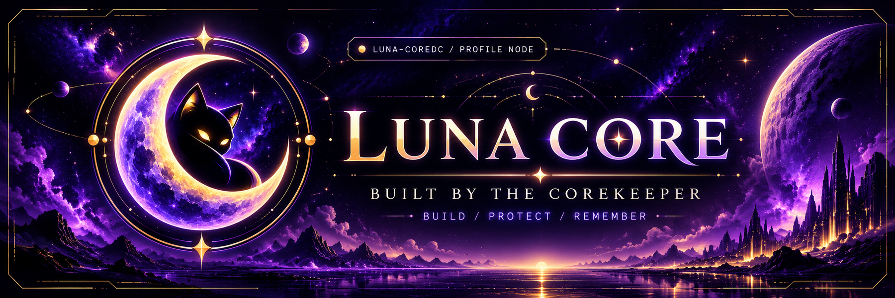
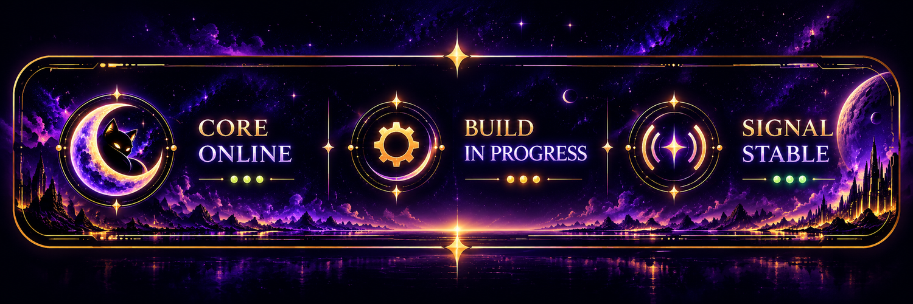
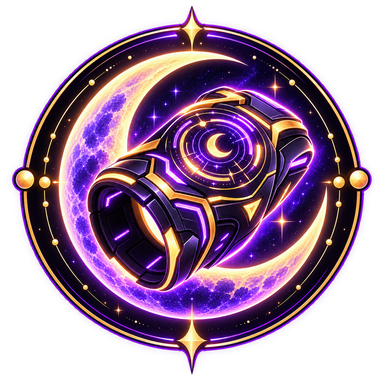
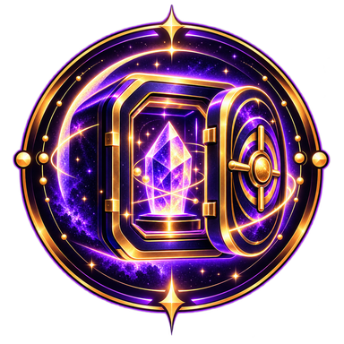
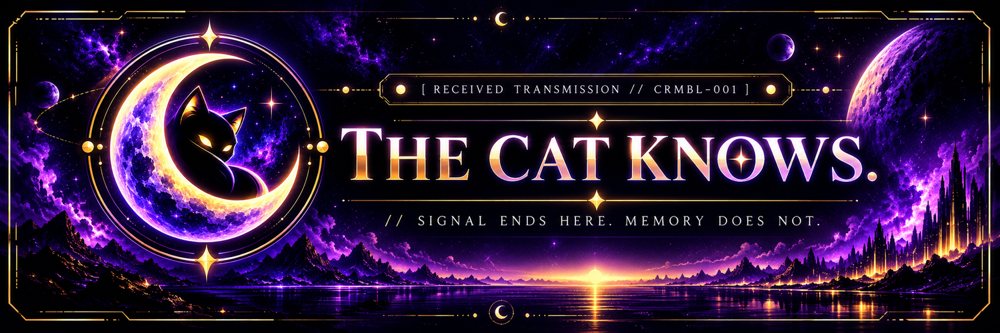

**COREKEEPER** &nbsp; · &nbsp; Founder & Creator of **Luna Core** &nbsp; · &nbsp; `@Luna-CoreDC`

*Building tools, companions, and worlds that remember.*

<a href="https://discord.gg/Ed9FRfnV4">Luna Core Community</a> &nbsp; • &nbsp; <a href="https://github.com/Luna-CoreDC?tab=repositories">Explore repositories</a> &nbsp; • &nbsp; <a href="mailto:luna-core@outlook.com">Contact</a>

 

## 👋 The person behind the Core

I'm **Corekeeper**, creator of Luna Core. My work sits at the crossroads of **Discord automation, native Android apps, companion interfaces, and interactive storytelling**.

I enjoy turning slightly wild ideas into prototypes you can actually run, including building and testing on Android with **Termux**. Practical tools on the surface; a little moonlit worldbuilding underneath.

> **Build what matters. Protect what you've built. Leave room for wonder.**

## 🛰️ Active project registry

<table>
<tr>
<td width="74"></td>
<td><strong>Luna Core: Discord Edition</strong> A multi-server Discord companion with moderation, Cookies, progression, achievements, games, and Crumble's increasingly suspicious expeditions. <code>V2 INDEPENDENT</code></td>
</tr>
<tr>
<td></td>
<td><strong>Moon-Core: Wristguard</strong> A native Android wearable-style dashboard for audio, maps, personal modules, and future connected companions. <code>ALPHA</code></td>
</tr>
<tr>
<td></td>
<td><strong>Moon-Vault</strong> A storage companion focused on finding, organising, and eventually safely offloading files across devices. <code>EARLY DEVELOPMENT</code></td>
</tr>
<tr>
<td></td>
<td><strong>COREVISION // Guardian Protocol</strong> An exploratory heads-up interface concept for contextual information, navigation, and verified device signals. <code>CONCEPT</code></td>
</tr>
</table>

### 🌘 Beyond the terminal

**Moonfall: Afterlight** explores hidden lore and memory through a Minecraft SMP. **HOMEBOUND // Project OMNIPRESENCE** explores how Luna and Crumble might one day inhabit a dedicated companion hub. These are developing creative/technical directions, not promises of released products.

## ⚙️ Tools in the workshop

`Python` · `Discord bots` · `Kotlin` · `Jetpack Compose` · `Android` · `Termux` · `Git & GitHub` · `Minecraft server tooling`

I care about making systems **usable, resilient, and understandable**, whether they run on a server or on the phone strapped to my wrist.

## 🌐 Connect with the Core

- **Community:** [Join the Luna Core Discord](https://discord.gg/Ed9FRfnV4)
- **Code:** [Browse my GitHub repositories](https://github.com/Luna-CoreDC?tab=repositories)
- **Email:** [luna-core@outlook.com](mailto:luna-core@outlook.com)

> Some repositories and prototypes may not be public yet. The registry above describes the projects, not their public release status.

---

<strong>🔒 OPEN CLASSIFIED TRANSMISSION // ACCESS: COREKEEPER</strong>

 

<pre>
  [ LUNA CORE : MEMORY ARCHIVE ]
  > Accessing node...
  > Signal source: UNKNOWN
  > Witness detected: CRUMBLE
  > The cat knows.
  > The Core remembers.
  > Connection closed.
</pre>

Nothing to see here. Definitely no missing Cookies. 🐈‍⬛

 

 
BUILT FOR THE CURIOUS · MAINTAINED BY THE COREKEEPER · OCCASIONALLY INTERRUPTED BY CRUMBLE

